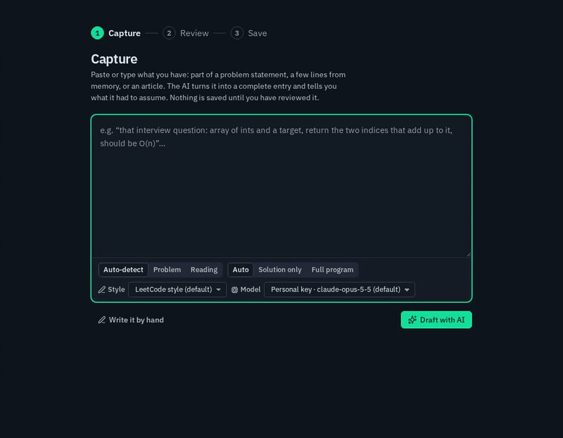

# Codeatrophy

Codeatrophy is a self-hosted library for coding challenges and technical
readings. Keep the problems you want to practise and the notes you want to
keep in one place, organise them with collections and tags, and solve problems
in the browser against your own test cases.



- **Problems and readings** in Markdown (with math and Mermaid diagrams), with
  tags, collections, difficulty and personal progress.
- **A judge built in.** Problems carry stdin/stdout test cases; "Run" and
  "Submit" execute your code in a sandbox ([Judge0](https://github.com/judge0/judge0))
  in C, C++, C#, Go, Java, JavaScript, Kotlin, Python, Ruby, Rust and TypeScript.
  A problem is either a full program or *solution only*, as on interview
  sites: you write just the function or class, and hidden per-language
  runner code turns it into a program; error messages point at your own
  lines.
- **AI drafting (optional).** Paste a half-remembered description and get a
  complete, reviewable item with the assumptions listed — solution-only or a
  full program, whichever fits — whose examples have already been checked by
  running the model's own reference solution; generate test cases whose
  expected outputs come from actually running a reference solution, and
  optionally one large case built by a generator program, so that a solution
  of the wrong complexity fails; derive
  easier, harder or twisted variants. Works with Anthropic or any
  OpenAI-compatible endpoint, including local models. Every request's
  tokens are counted per provider, and an activity log keeps what was sent
  and what came back.
- **An MCP server** so an AI assistant (Claude Code, Claude Desktop, ...) can
  read, write and test items in your library directly.
- **Portable bundles.** Export any part of the library as a zip of plain
  JSON, Markdown and source files, and import it elsewhere without
  duplicates.

It runs as a Docker Compose stack: one Go server (web UI, HTTP API and MCP
endpoint), its PostgreSQL database, and the Judge0 containers. The server
can keep the library in a single SQLite file instead.

## Quick start

Requirements: Docker with Compose v2.24 or later. The judge needs a
privileged container (see [Security](#security)).

```sh
git clone https://github.com/YAPhoa/codeatrophy.git
cd codeatrophy
cp .env.example .env      # adjust if you like; the defaults work
docker compose up -d --build
```

Open <http://localhost:8484>. The first start takes a minute while Judge0
initialises its database; the judge shows as unavailable until then.

The first visit asks you to create your account: choose the email and
password you want to sign in with. A sign-in lasts 30 days from the last time you used the app in that browser. See
[Signing in](docs/signing-in.md) to turn sign-in off or manage accounts.

To stop: `docker compose down` (your data stays in the `codeatrophy-db` and
`codeatrophy-data` volumes).

### Without the judge

Set `CODEATROPHY_JUDGE_ENGINE=none` and remove `judge0` from
`COMPOSE_PROFILES` in `.env`. The Judge0 containers are then not started and
the UI hides run and submit; the library, AI drafting, bundles and MCP keep
working.

## Configuration

Everything is configured with environment variables, all documented in
[`.env.example`](.env.example). The most common ones:

| Variable | Default | Purpose |
| --- | --- | --- |
| `CODEATROPHY_HOST_PORT` | `8484` | Port on the host |
| `CODEATROPHY_BIND_ADDRESS` | `127.0.0.1` | Host address to publish on |
| `CODEATROPHY_PUBLIC_URL` | unset | URL the instance is reached at, when not `localhost` |
| `CODEATROPHY_ALLOWED_HOSTS` | unset | Extra host names or addresses the server answers to (see [Security](#security)) |
| `CODEATROPHY_JUDGE_ENGINE` | `judge0` in `.env.example` | `judge0` or `none` |
| `CODEATROPHY_SECRET_KEY` | generated | Key that encrypts stored API keys |
| `CODEATROPHY_DATABASE_URL` | the Compose `db` service | PostgreSQL URL; empty for SQLite (see [Storage](docs/storage.md)) |
| `CODEATROPHY_POSTGRES_PASSWORD` | `codeatrophy-postgres` | Password of the Compose database; change it before the first start |
| `CODEATROPHY_DB_AUTO_MIGRATE` | `on` | Apply schema migrations at startup; `off` leaves them to `db migrate` (see [Upgrading](docs/storage.md#upgrading)) |
| `CODEATROPHY_AI_PROVIDER` | unset | Initial default AI provider: the environment provider of `anthropic`, `gemini` or `openai_compatible` |
| `ANTHROPIC_API_KEY`, `GEMINI_API_KEY`, `OPENAI_API_KEY` | unset | Keys of the environment providers, for unattended setups |
| `CODEATROPHY_AI_BLOCK_PRIVATE` | `false` | Also refuse loopback and private addresses as AI provider base URLs (see [Security](#security)) |
| `CODEATROPHY_AI_ALLOWED_HOSTS` | unset | Host names, addresses or CIDR prefixes AI providers may reach whatever the rules say |
| `CODEATROPHY_AUTH` | `on` | Require signing in to the web UI and API; `off` skips it (see [Signing in](docs/signing-in.md)) |
| `CODEATROPHY_SESSION_TTL` | `720h` | How long a sign-in lasts without being used |
| `CODEATROPHY_TRUSTED_PROXIES` | unset | Addresses or CIDR prefixes of reverse proxies whose `X-Forwarded-For` is believed (see [Signing in](docs/signing-in.md)) |
| `CODEATROPHY_MCP_TOKEN` | unset | Server-wide bearer token for `/mcp`, besides the per-account tokens made in the UI |
| `CODEATROPHY_LOG_LEVEL`, `CODEATROPHY_LOG_FORMAT` | `info`, `text` | Log level (`debug`, `info`, `warn`, `error`) and format (`text`, `json`) |
| `CODEATROPHY_ACCESS_LOG` | `off` | Log every request (method, path, status, client) at info instead of debug |

AI providers are normally set up in the UI under Settings. You can keep
several, such as a work key, a personal one and a local model server, and
choose one as the default the AI features use. For each, enter the key, test
the connection, pick a model from the list the service reports, and save.
Keys entered there are stored encrypted (AES-256-GCM) and are never shown
again, logged, exported or exposed over MCP. Environment variables (see
`.env.example`) add a read-only provider per kind for unattended setups;
they do not change the providers saved in the UI.

With Anthropic, the default model is `claude-opus-5-5`. For models that
support it, requests to the Anthropic API ask for the server-side refusal
fallback, so a request declined by the model's safety classifiers is answered
by a fallback model instead of failing.

Style presets (Settings → Styles) hold your own standing instructions for how
drafted items should be written, such as statement layout, tone or starter
languages. One preset can be the default. A new instance starts with three
built-in presets (Interview practice, the default; Contest style; Study
notes), which you can edit or delete like your own; deleted ones do not come
back.

## Connecting an MCP client

The MCP endpoint is `http://localhost:8484/mcp` (Streamable HTTP).

```sh
claude mcp add --transport http codeatrophy http://localhost:8484/mcp
```

Clients that only speak stdio can bridge with
`npx mcp-remote http://localhost:8484/mcp`. While sign-in is on, make a
token under Settings → MCP server → Tokens; the UI shows the command with
the token filled in, such as
`claude mcp add --transport http codeatrophy http://localhost:8484/mcp --header "Authorization: Bearer cat_..."`.

Over MCP the connected assistant does the writing; the server stores items,
searches, and runs code to verify test cases. No AI provider needs to be
configured for this. See [`docs/mcp.md`](docs/mcp.md) for the tools and
prompts.

## Security

- **Sign-in.** The web UI and the API need a signed-in session, and `/mcp`
  a bearer token (see [Signing in](docs/signing-in.md)). The Compose file still
  publishes the app on `127.0.0.1` only. To expose it beyond the local
  machine, serve it over HTTPS (a reverse proxy such as Nginx Proxy Manager
  or Caddy), keep sign-in on, and set `CODEATROPHY_PUBLIC_URL` to the public
  URL (its origin is then allowed to make changes, and MCP clients are told
  the endpoint's URL). With `CODEATROPHY_AUTH=off` anyone who can reach the
  port can read and change the library and run code on the judge.
  AI generations run in the background, but verification runs, bundle
  transfers and connection tests can take minutes: raise the proxy's read
  timeout to at least six minutes for `/api/v1/items/check`,
  `/api/v1/items/*/testcases/verify`, `/api/v1/export`, `/api/v1/import*`,
  `/api/v1/settings/ai/test` and `/api/v1/settings/ai/models`, and leave
  `/mcp` unbuffered with a long timeout, since it streams.
- **Host names it answers to (DNS rebinding).** The API and `/mcp` answer
  only to requests whose `Host` is `localhost` or a loopback address, the host
  of `CODEATROPHY_PUBLIC_URL`, the host of an allowed origin, or a host listed
  in `CODEATROPHY_ALLOWED_HOSTS`; anything else gets `403`. This stops a web
  page whose DNS name has been re-pointed at your machine from using the app.
  To reach the app from other machines on your network (after setting
  `CODEATROPHY_BIND_ADDRESS`), set `CODEATROPHY_PUBLIC_URL` to the URL you
  use, or list the name or address in `CODEATROPHY_ALLOWED_HOSTS`, for
  example `CODEATROPHY_ALLOWED_HOSTS=192.168.1.20,nas.local`. The port does
  not matter, so remapping `CODEATROPHY_HOST_PORT` needs no change.
- **Cross-site requests.** State-changing requests from web pages on other
  origins are rejected, on the API and on `/mcp`: only loopback origins and
  the configured ones (`CODEATROPHY_PUBLIC_URL`, `CODEATROPHY_ALLOWED_ORIGINS`,
  `CODEATROPHY_MCP_ALLOWED_ORIGINS`, and origins on an allowed host) may make
  changes. Set `CODEATROPHY_MCP_TOKEN` before making `/mcp` reachable from
  other machines.
- **API keys stay with their provider.** A stored key is bound to the origin
  of the base URL it was saved for. Pointing a provider at another base URL
  without entering a new key deletes the stored key, and a connection test
  against another URL never sends a stored key. A provider that redirects
  to another origin is not followed, so the key does not travel with the
  redirect.
- **Addresses AI providers may reach.** A provider's base URL is chosen in
  the settings, so the server refuses to connect to cloud metadata and
  other link-local addresses (such as `169.254.169.254`, where a cloud VPS
  hands out its credentials). Loopback and private addresses stay
  reachable, so a model server on the same machine or your network
  (Ollama, LM Studio) works without setup. When people you don't fully
  trust have accounts, set `CODEATROPHY_AI_BLOCK_PRIVATE=true` to refuse
  loopback and private addresses too, and list the model servers they may
  use in `CODEATROPHY_AI_ALLOWED_HOSTS`, for example
  `CODEATROPHY_AI_ALLOWED_HOSTS=ollama,192.168.1.30`.
- **The judge runs untrusted code.** Judge0's sandbox (isolate) requires its
  worker container to run `privileged`. The Judge0 containers sit on an
  internal network without internet access, and submissions run without
  network. Treat the host accordingly. Judge0 keeps no copy of what it ran:
  the app deletes each submission there once it has read the result.
  The sandbox limits each process, so the worker container as a whole is
  capped at 4 GB of memory and 1024 processes, and a program that forks
  cannot use up the host's memory and take the database down with it. Raise
  `JUDGE0_WORKERS_MEMORY` (and `JUDGE0_WORKERS_PIDS`) if you raise
  `JUDGE0_WORKER_COUNT` or set problems near the 2 GiB memory maximum;
  `JUDGE0_WORKERS_CPUS` caps CPU, which is not capped by default.
- **cgroup v2 hosts.** Judge0 1.13's sandbox can only use control groups on
  cgroup v1, which most current distributions no longer provide. Codeatrophy
  therefore asks Judge0 for per-process limits by default
  (`CODEATROPHY_JUDGE0_CGROUPS=false`). In this mode:
  - the memory limit is an address-space limit. Runtimes that reserve large
    virtual ranges get an extra allowance (64 MB for C, C++, Rust and Python;
    128 MB for Go, Ruby and C#; 768 MB for JavaScript and TypeScript; 512 MB
    above the Java/Kotlin heap). For C, C++, Rust, Python, Go and Ruby the
    problem's limit is then enforced on the program's peak resident memory;
    Java and Kotlin run with `-Xmx` set to the limit; for C#, JavaScript and
    TypeScript the limit is approximate.
  - a running program is stopped by the wall-clock limit (about one second
    above the time limit); CPU time is checked when it exits.
  - memory-limit verdicts are recognised from the runtime's allocation error
    (`MemoryError`, `std::bad_alloc`, `OutOfMemoryError`, ...) or from the
    peak memory, since Judge0 reports no memory-limit status.
  - a Java or Kotlin program — the source, or for a solution-only problem the
    runner code with the solution — may be at most 10 MiB (Judge0's
    `MAX_EXTRACT_SIZE`); a larger one is refused with a validation error.
  On a cgroup v1 host you can set `CODEATROPHY_JUDGE0_CGROUPS=true` for
  Judge0's cgroup accounting instead.
- **AI input.** Generated drafts are never saved without your review, model
  output is schema-checked, and text you paste is passed to the model as data,
  not instructions.

## Development

Layout: `cmd/` and `internal/` hold the Go server, `web/` the React UI,
`docs/` the design documents. Start with
[`docs/architecture.md`](docs/architecture.md); the HTTP API in
[`docs/api.md`](docs/api.md) is the contract between server and UI.

```sh
make help          # all targets
make test          # Go tests (SQLite)
make test-postgres # Go tests on PostgreSQL, against a throwaway server in Docker
make lint          # go vet, gofmt check, UI lint and type check
make web-dev-mock  # UI dev server with an in-memory API mock
make run           # server on 127.0.0.1:8484 with data in ./data
make build         # UI + server binary with the UI embedded (bin/codeatrophy)
make up            # the whole Compose stack
```

The Makefile uses Go and npm from your machine when they are installed and
otherwise runs them in the official Docker images, so Docker alone is enough.
A server binary built without the UI (`make build-server`, or plain
`go build ./...`) serves a placeholder page; the Docker image always
contains the UI.

[`CONTRIBUTING.md`](CONTRIBUTING.md) has the rules for a change: how large a
commit may be, the checks to run, and what must change together.

## License

Copyright (C) 2026 YAPhoa

Codeatrophy is licensed under the GNU Affero General Public License v3.0 only
(SPDX: `AGPL-3.0-only`); see [`LICENSE`](LICENSE). In plain terms: if you run a
modified version as a network service, you must offer its source code to that
service's users.

Judge0 is separate software under its own license (GPL-3.0). Codeatrophy runs
it as an independent service, reached over HTTP; none of its code is included
in this project.

The web UI bundles two fonts under the SIL Open Font License 1.1: IBM Plex Sans
(Copyright 2019 IBM Corp.), installed from the `@fontsource-variable/ibm-plex-sans`
package, and JetBrains Mono (Copyright 2020 The JetBrains Mono Project Authors),
cut down to ASCII for the wordmark, with its license in
[`web/src/assets/fonts/JetBrainsMono-OFL.txt`](web/src/assets/fonts/JetBrainsMono-OFL.txt).
