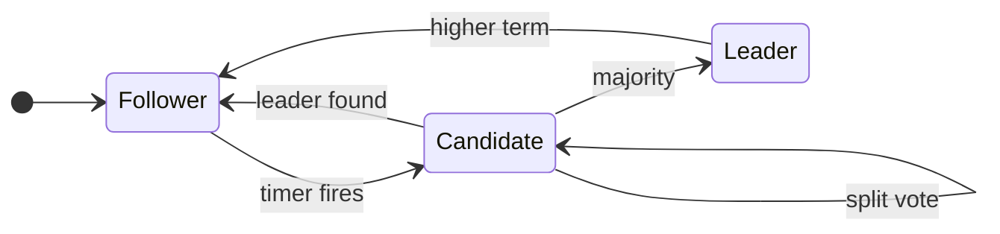

Cheat sheet for the election half of Raft (Ongaro & Ousterhout, 2014). Log replication is a separate note I have not written yet.

## States

Every server is a **follower**, a **candidate** or the **leader**. Time is divided into numbered **terms**; each term has at most one leader.

- Follower
  - Responds to RPCs; never initiates.
  - Resets its election timer on a valid `AppendEntries` from the current leader, or when it grants a vote.
  - Timer fires → becomes a candidate.
- Candidate
  - Increments `currentTerm`, votes for itself, sends `RequestVote` to everyone.
  - Majority of votes → leader.
  - `AppendEntries` from a leader with term ≥ its own → back to follower.
  - Timer fires again → new term, new election.
- Leader
  - Sends heartbeats (empty `AppendEntries`) immediately and then periodically.
  - Sees a higher term anywhere → steps down.

## Granting a vote

A server grants its vote for term $T$ only if **all** of these hold:

1. $T \ge$ its `currentTerm`.
2. It has not already voted for someone else in term $T$. (`votedFor` is persisted *before* replying.)
3. The candidate's log is **at least as up to date** as its own: a higher last term wins; with equal last terms, the longer log wins.

Rule 3 is the election restriction. It guarantees the winner already holds every committed entry, so a new leader never needs to be "caught up" by followers.

## Timing

$$
\text{broadcastTime} \ll \text{electionTimeout} \ll \text{MTBF}
$$

Election timeouts are **randomised** per server (the paper suggests 150–300 ms), so that one server usually times out first and wins before the others start competing. Without randomisation, split votes can repeat indefinitely.

## Things I keep getting wrong

- A leader does **not** step down merely because it cannot reach a majority. It keeps believing it is leader until it hears of a higher term. Stale reads from such a leader are the reason for `ReadIndex` and leader leases.
- A partitioned follower keeps incrementing its term. When it rejoins, its high term forces the healthy leader to step down. The **pre-vote** extension fixes this: ask "would you vote for me?" before incrementing.
- `currentTerm` and `votedFor` must be on stable storage before answering any RPC. Voting twice in one term after a restart breaks everything.

## To do

- [x] Re-read §5.2 and §5.4.1
- [ ] Write the log replication note
- [ ] Work through the Figure 8 scenario by hand
- [ ] Try the MIT 6.5840 lab 3A
