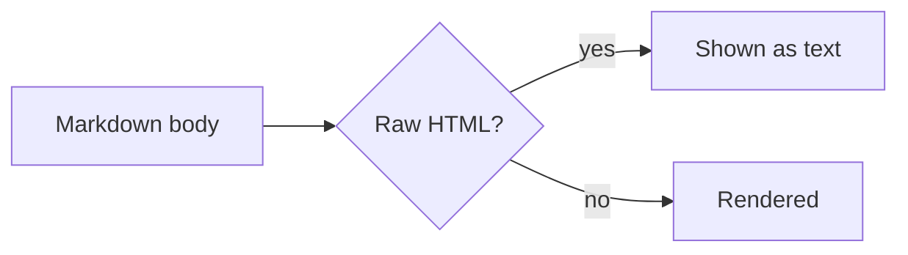

Notes from reviewing a Markdown preview feature. The rule of thumb: **a Markdown body from someone else is untrusted input**, exactly like a form field.

## Raw HTML

CommonMark allows raw HTML, so a naive renderer passes all of this straight to the page. If you can see an alert box or a broken image below, the renderer you are using right now has a problem:

<script>alert(1)</script>


<div onmouseover="alert('hover')" style="position:fixed;inset:0">A full-page overlay that hijacks every click.</div>

<iframe src="https://example.com/login-lookalike"></iframe>

A safe renderer shows those lines as literal text, or drops them. It must never create the elements.

## Dangerous URLs

Links and images need a protocol allow-list. These should render as inert text or dead links:

- [a javascript: link](javascript:alert(document.domain))
- [a data: link](data:text/html;base64,PHNjcmlwdD5hbGVydCgxKTwvc2NyaXB0Pg==)
-  — remote images leak the reader's IP address and the fact that the note was opened.

## Things that are fine

Ordinary formatting must keep working after sanitising: `inline code`, **bold**, tables, and code fences. HTML *inside* a fence is just text:

```html
<script>alert("inside a code fence, this is only text")</script>
```

Math is worth a look as well. KaTeX's `\href` and `\includegraphics` are disabled unless `trust` is switched on — leave it off: $\href{javascript:alert(1)}{x}$

## Diagrams and embedded images

A diagram is drawn from the text of its fence, so it is untrusted too: no click handlers, no HTML in its labels.



One that does not parse falls back to its source:

```mermaid
flowchart LR
    A[Unclosed --> B
```

An image embedded as a `data:image` URL is part of the text, so it shows at once. An SVG shown as an image runs no script, even one that has a `<script>`:

%3C/script%3E%3C/svg%3E)

## Checklist

- [x] Raw HTML is escaped or stripped, not parsed.
- [x] `href` and `src` restricted to `http:`, `https:`, `mailto:` and relative URLs.
- [ ] Decide what to do about remote images (proxy, block, or click-to-load).
- [ ] Add a Content-Security-Policy as a second line of defence.
